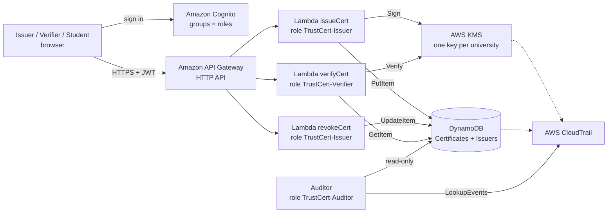

# TrustCert – Credential Verification System

ITE183 Midterm Project · Topic: **Decentralized Trust Management (DTM)** · Section **VvWw** · Region **ap-southeast-1 (Singapore)**

A school or organization issues a digital credential, such as a certificate or diploma, and anyone can verify it without contacting the main authority. No single person or system controls access, because control is split across four roles: **Issuers, Verifiers, Auditors, and Users (students)**. Each role holds only the permissions it needs (least privilege), and every action is recorded, so trust can be checked.

Example: MSU issues a digital certificate to a student. Another university verifies whether it is authentic.

## What's in this repository

| Path | What it is |
|---|---|
| `index.html` | Working browser demo. Open it in Chrome or Edge. It uses real ECDSA P-256 signatures, the same algorithm the AWS KMS keys use. |
| `aws/lambda/issue_cert.py` | `POST /issue`: an Issuer signs a certificate with its university's own KMS key |
| `aws/lambda/verify_cert.py` | `POST /verify`: a Verifier checks the signature, revocation, and its trust list |
| `aws/lambda/revoke_cert.py` | `POST /revoke`: only the issuing university's Issuer can revoke |
| `aws/iam/TrustCert-Issuer.json` | IAM policy for the Issuer role |
| `aws/iam/TrustCert-Verifier.json` | IAM policy for the Verifier role |
| `aws/iam/TrustCert-Auditor.json` | IAM policy for the Auditor role (read-only, with an explicit Deny on changes) |
| `aws/iam/kms-key-policy-partner-verify.json` | Example key policy: a partner university's account may *verify* with MSU's key but never *sign* |

## Roles and least privilege

| Role | Who | Can do | Cannot do | AWS |
|---|---|---|---|---|
| **Issuer** | Registrar staff | Sign certificates, revoke its own certificates | Verify for others, read the audit log | IAM role `TrustCert-Issuer`: `kms:Sign`, `dynamodb:PutItem`/`UpdateItem` |
| **Verifier** | Admissions / HR of another school | Verify certificates, manage its school's trust list | Sign or revoke | IAM role `TrustCert-Verifier`: `kms:Verify`, `dynamodb:GetItem` |
| **Auditor** | Compliance office | Read the audit trail and records | Change anything (explicit Deny) | IAM role `TrustCert-Auditor`: `cloudtrail:LookupEvents`, read-only DynamoDB |
| **User (Student)** | Certificate holder | Hold and share own certificates | Issue, edit, revoke | No IAM role, Cognito group `student` only |

Cognito groups decide which person gets which role: `msu-issuer`, `nsu-verifier`, `auditor`, `student`.

## How it shows Decentralized Trust Management

| DTM idea | In TrustCert | AWS service |
|---|---|---|
| No central authority | Each university has its own signing key and its own records | AWS KMS (one key per university) |
| Separation of control | Issuer, Verifier, Auditor, and User roles | AWS IAM + Amazon Cognito groups |
| Credentials | A certificate is signed data anyone can check | KMS `Sign` / `Verify` |
| Trust policy and delegation | Each university chooses whom it trusts. If NSU trusts MSU and CVC trusts NSU, CVC accepts MSU certificates. | DynamoDB `trusts` list |
| Revocation | The issuer can withdraw a certificate | DynamoDB `status = REVOKED` |
| Accountability | Every action, including denied ones, is logged | AWS CloudTrail |

## Architecture



**Verification flow:** the Verifier signs in with Cognito → sends the certificate to API Gateway → `verifyCert` (running as `TrustCert-Verifier`) loads the issuer from DynamoDB → KMS `Verify` checks the signature → DynamoDB is checked for revocation → the Verifier's trust list decides → the verdict returns. CloudTrail records the KMS call for the Auditor.

## Running the demo

Open `index.html` in a browser. Use **Acting as** to pick the university and **Role** to pick the role. Start as NSU · Verifier, then try:

1. **Verify** shows the sample MSU certificate as Verified.
2. **Tamper with it** → Verify: the signature fails ("Not authentic").
3. As Verifier, open **Issue**: Access denied, because a Verifier cannot sign (least privilege). Press **Switch to Issuer**.
4. As MSU · Issuer, issue a certificate, then **Switch to Verifier and check it**.
5. As MSU · Issuer → **Issued records** → Revoke. Then verify again: "Revoked".
6. Switch to **CVC · Verifier** and verify: trusted through NSU (delegation).
7. **Student** role → **My credentials**: the student holds and shares certificates but can't change them.
8. **Auditor** role → **Audit log**: every action, including denied attempts, with its matching AWS API call. The records are read-only.

## Deploying on AWS (Singapore, ap-southeast-1)

> Before you start, create a **Budget** alert (Billing → Budgets) of USD 1–2.
> Check that the region selector in the top right says **Asia Pacific (Singapore)** on every page.
> Tag **every** resource: `CreatedBy` = your I.E and group number, `CreatedDate` = `YYYY-MM-DD`, `Project` = `ITE183 Project`.

### 1. DynamoDB: two tables
- `TrustCert-Issuers`, partition key `issuerId` (String)
- `TrustCert-Certificates`, partition key `certId` (String)

### 2. KMS: one signing key per university
- Key type **Asymmetric**, usage **Sign and verify**, spec **ECC_NIST_P256**. Aliases `trustcert-msu`, `trustcert-nsu`.
- ⚠️ A customer-managed key costs about USD 1 per month, prorated by the hour. Schedule deletion (7-day minimum) when you finish. If your group can't use KMS, the rest still works as a design and the demo shows the signing step.

### 3. Issuer records (DynamoDB → Explore items → Create item → JSON view, "View DynamoDB JSON" off)
```json
{ "issuerId": "msu", "name": "MSU", "kmsKeyId": "<MSU key ARN>", "keyFingerprint": "<MSU key ID>", "trusts": ["nsu"] }
```
```json
{ "issuerId": "nsu", "name": "Northport State University", "kmsKeyId": "<NSU key ARN>", "keyFingerprint": "<NSU key ID>", "trusts": ["msu"] }
```

### 4. IAM: three roles
| Role name | Trusted entity | Policy file |
|---|---|---|
| `TrustCert-Issuer` | Lambda | `aws/iam/TrustCert-Issuer.json` |
| `TrustCert-Verifier` | Lambda | `aws/iam/TrustCert-Verifier.json` |
| `TrustCert-Auditor` | Your AWS account (an auditor IAM user assumes it) | `aws/iam/TrustCert-Auditor.json` |

Replace `ACCOUNT_ID`, `MSU_KEY_ID`, `NSU_KEY_ID` in the files.

### 5. Lambda: three functions (Python 3.12)
| Function | Code | Execution role |
|---|---|---|
| `trustcert-issue` | `issue_cert.py` | `TrustCert-Issuer` |
| `trustcert-revoke` | `revoke_cert.py` | `TrustCert-Issuer` |
| `trustcert-verify` | `verify_cert.py` | `TrustCert-Verifier` |

Set **Handler** to `<file name>.lambda_handler` (for example `issue_cert.lambda_handler`). Add environment variables `CERTS_TABLE` and `ISSUERS_TABLE`.

### 6. Cognito: user pool
- Create a user pool with an app client (no client secret).
- Create groups `msu-issuer`, `nsu-verifier`, `auditor`, `student`. Add one test user to each.

### 7. API Gateway: HTTP API
- Routes: `POST /issue`, `POST /verify`, `POST /revoke` → the matching Lambda.
- Add a **JWT authorizer** using the Cognito user pool and attach it to all three routes.

### 8. Test
Sign in as the `msu-issuer` user to get an ID token, then:

```bash
curl -X POST "$API/issue" -H "Authorization: Bearer $TOKEN" -H "Content-Type: application/json" \
  -d '{"issuerId":"msu","name":"Juan Dela Cruz","studentId":"2022-00123","title":"Bachelor of Science in Information Technology","honors":"Cum Laude","dateConferred":"2026-06-15"}'
```

Sign in as the `nsu-verifier` user, then:

```bash
curl -X POST "$API/verify" -H "Authorization: Bearer $TOKEN" -H "Content-Type: application/json" \
  -d '{"verifierId":"nsu","certificate": <paste the certificate returned by /issue>}'
```

Least-privilege test: call `/issue` with the verifier's token. It returns **403**.

### 9. CloudTrail
CloudTrail → **Event history** → filter *Event name* = `Sign` or `Verify`. Screenshot it as the Auditor's evidence.

### 10. Clean up
Delete the API, the three Lambdas, the Cognito user pool, both tables, and the three IAM roles. Schedule deletion of the KMS keys.

## Screenshots to collect for the presentation

1. IAM roles `TrustCert-Issuer`, `TrustCert-Verifier`, `TrustCert-Auditor` and their policies
2. Cognito user pool groups
3. DynamoDB tables with tags
4. KMS keys (ECC_NIST_P256, Sign and verify)
5. Lambda functions and a successful test
6. API Gateway routes and the JWT authorizer
7. CloudTrail events showing `Sign` / `Verify`
8. The demo: Verified, Tampered, Access denied, Revoked, Delegated trust, Audit log

## Research-only extension (not Free Tier)

**Amazon Neptune** could store the trust network as a graph (universities as nodes, "trusts" as edges) for multi-step trust paths across many institutions. It isn't in the Free Tier, so it is explained here and not deployed.
