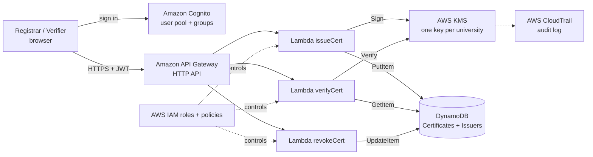

# TrustCert – Decentralized Academic Credential Verification

ITE183 Midterm Project · Topic: **Decentralized Trust Management (DTM)** · Section **VvWw** · Region **ap-southeast-1 (Singapore)**

Universities issue, share, and verify academic credentials without depending on one central institution.
Example: MSU signs a digital certificate for a student. Another university checks that it is authentic.

## What's in this folder

| Path | What it is |
|---|---|
| `index.html` | Working browser demo. Open it in Chrome or Edge. It uses real ECDSA P-256 signatures, the same algorithm the AWS KMS keys use. |
| `aws/lambda/issue_cert.py` | Lambda for `POST /issue`: signs a certificate with the issuer's own KMS key |
| `aws/lambda/verify_cert.py` | Lambda for `POST /verify`: checks the signature, revocation, and the verifier's trust list |
| `aws/lambda/revoke_cert.py` | Lambda for `POST /revoke`: only the issuer can revoke its certificates |
| `aws/iam/lambda-role-policy.json` | Least-privilege IAM policy for the Lambda role |
| `aws/iam/kms-key-policy-partner-verify.json` | Example key policy: a partner university's AWS account may *verify* with MSU's key but never *sign* |

## How it shows Decentralized Trust Management

| DTM idea | In TrustCert | AWS service |
|---|---|---|
| No central authority | Each university has its own signing key and its own records | AWS KMS (one key per university) |
| Credentials | A certificate is signed data anyone can check | KMS `Sign` / `Verify` |
| Trust policy | Each university decides which issuers it accepts | DynamoDB `trusts` list, IAM policies |
| Delegation | If NSU trusts MSU, and CVC trusts NSU, CVC accepts MSU certificates | `verify_cert.py` trust path |
| Authentication | Only MSU staff can issue as MSU | Amazon Cognito groups |
| Revocation | The issuer can withdraw a certificate | DynamoDB `status = REVOKED` |
| Accountability | Every key use is logged | AWS CloudTrail |

## Architecture



**Request flow for verification:** the verifier signs in with Cognito → sends the certificate to API Gateway → `verifyCert` loads the issuer from DynamoDB → KMS `Verify` checks the signature → DynamoDB is checked for revocation → the verifier's trust list decides → the verdict returns. CloudTrail records the KMS call.

## Running the demo

Open `index.html` in a browser. Start from **Verify** (acting as Northport State University), then try:

1. **Tamper with it** → Verify: the signature fails ("Not authentic").
2. Switch *Acting as* to **CVC** → Load latest issued → Verify: trusted through NSU (delegation).
3. Switch to **MSU** → **Issued records** → Revoke → Verify: "Revoked".
4. **Trust network**: add a new university. It can't verify MSU until it chooses to trust someone.
5. **Audit log**: every action with its matching AWS API call.

## Deploying on AWS (Singapore, ap-southeast-1)

> Before you start, create a **Budget** alert (Billing → Budgets) of USD 1–2.
> Check the region selector in the top right says **Asia Pacific (Singapore)** on every page.
> Tag **every** resource: `CreatedBy` = your I.E and group number, `CreatedDate` = `YYYY-MM-DD`, `Project` = `ITE183 Project`.

### 1. DynamoDB: two tables
- `TrustCert-Issuers`, partition key `issuerId` (String)
- `TrustCert-Certificates`, partition key `certId` (String)
- Capacity: on-demand, or provisioned at 1 RCU / 1 WCU (free tier).

### 2. KMS: one signing key per university
- Key type **Asymmetric**, usage **Sign and verify**, spec **ECC_NIST_P256**.
- Aliases: `trustcert-msu`, `trustcert-nsu`.
- ⚠️ A customer-managed key costs about USD 1 per month, prorated by the hour. Schedule deletion (7-day minimum) as soon as you finish.

### 3. Add issuer records (DynamoDB → Explore items → Create item → JSON view)
```json
{ "issuerId": "msu", "name": "MSU", "kmsKeyId": "<MSU key ARN>", "keyFingerprint": "<MSU key ID>", "trusts": ["nsu"] }
```
```json
{ "issuerId": "nsu", "name": "Northport State University", "kmsKeyId": "<NSU key ARN>", "keyFingerprint": "<NSU key ID>", "trusts": ["msu"] }
```
Turn off "View DynamoDB JSON" so `trusts` is saved as a plain list.

### 4. IAM: role for the Lambdas
- Create role → trusted entity **Lambda** → add an inline policy from `aws/iam/lambda-role-policy.json`.
- Replace `ACCOUNT_ID`, `MSU_KEY_ID`, `NSU_KEY_ID`.

### 5. Lambda: three functions (Python 3.12)
- `trustcert-issue` ← `issue_cert.py`, `trustcert-verify` ← `verify_cert.py`, `trustcert-revoke` ← `revoke_cert.py`
- Set **Handler** to `<file name>.lambda_handler` (for example `issue_cert.lambda_handler`), or paste the code into the default `lambda_function.py`.
- Use the role from step 4. Add environment variables `CERTS_TABLE` and `ISSUERS_TABLE`.

### 6. Cognito: user pool
- Create a user pool with an app client (no client secret).
- Create groups `msu` and `nsu`. Add a test user to each.

### 7. API Gateway: HTTP API
- Routes: `POST /issue` → trustcert-issue, `POST /verify` → trustcert-verify, `POST /revoke` → trustcert-revoke.
- Authorization: add a **JWT authorizer** using the Cognito user pool. Attach it to `/issue` and `/revoke` (and `/verify` if verifiers must sign in).

### 8. Test
Get an ID token for the MSU user (Cognito Hosted UI, or `aws cognito-idp initiate-auth`), then:

```bash
curl -X POST "$API/issue" -H "Authorization: Bearer $TOKEN" -H "Content-Type: application/json" \
  -d '{"issuerId":"msu","name":"Juan Dela Cruz","studentId":"2022-00123","title":"Bachelor of Science in Information Technology","honors":"Cum Laude","dateConferred":"2026-06-15"}'
```

```bash
curl -X POST "$API/verify" -H "Authorization: Bearer $TOKEN" -H "Content-Type: application/json" \
  -d '{"verifierId":"nsu","certificate": <paste the certificate returned by /issue>}'
```

### 9. CloudTrail
CloudTrail → **Event history** → filter *Event name* = `Sign` or `Verify`. Screenshot it as your audit evidence.

### 10. Clean up
Delete the API, the three Lambdas, the Cognito user pool, both tables, and the IAM role. Schedule deletion of the KMS keys.

## Screenshots to collect for the presentation

1. DynamoDB tables with tags
2. KMS keys (key spec ECC_NIST_P256, usage Sign/Verify)
3. IAM role policy
4. Lambda functions and a successful test result
5. API Gateway routes and authorizer
6. Cognito user pool groups
7. CloudTrail events showing `Sign` / `Verify`
8. The demo: Verified / Tampered / Revoked / Delegated trust

## Research-only extension (not Free Tier)

**Amazon Neptune** could store the trust network as a graph (universities as nodes, "trusts" as edges) for multi-step trust paths across many institutions. It isn't in the Free Tier, so it is explained here and not deployed.
